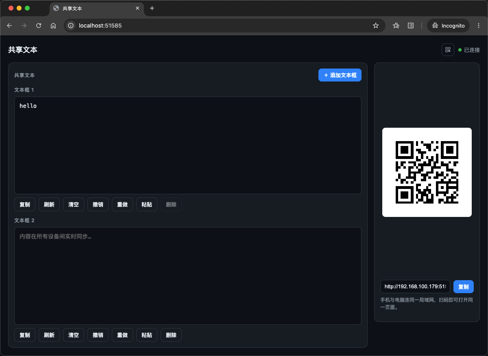
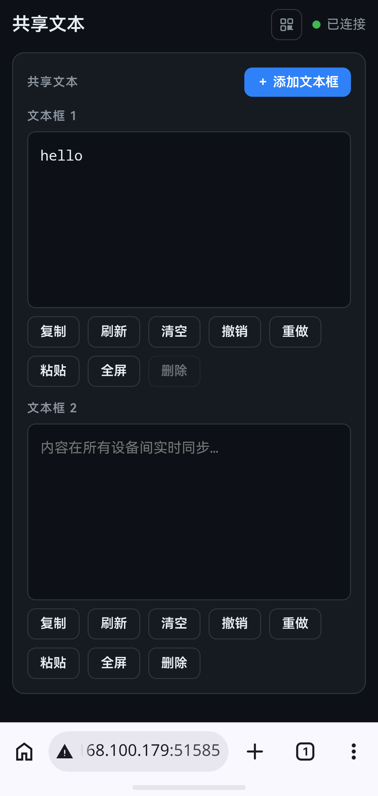

# share-text

局域网内的即时文本共享工具。启动一个本地 HTTP 服务，生成二维码，手机扫码即可打开同一页面，任意设备在文本框中粘贴/输入的内容实时同步给所有设备。

## 功能

- **多文本框**：可动态添加/删除文本框，每框独立实时同步，方便双向互发数据
- **二维码共享**：页面链接生成二维码，手机扫码即入，自动保持首个文本框不可删除
- **实时同步**：SSE 推送，其他设备修改内容即时可见；支持横向文本全屏编辑（手机端聚焦自动全屏）
- **撤销 / 重做**：每个文本框独立的历史记录（最近 10 次），撤销只能后退、重做只能前进
- **复制 / 粘贴**：一键复制内容；手机端粘贴按钮直接读剪贴板（不支持时引导长按粘贴）
- **持久化**：内容与历史自动存储到本地 JSON 文件，重启不丢失




## 使用

```bash
go run .                 # 随机端口启动，并自动打开浏览器
go run . -port 8080      # 指定端口
go run . -no-open        # 不自动打开浏览器
go run . -data /path/file.json   # 自定义数据文件
```

启动后终端会打印局域网地址（如 `http://192.168.100.179:xxxxx/`），手机与电脑连同一局域网，扫码即可打开同一页面。

首次运行 macOS 会弹窗询问是否允许传入连接，点「允许」。

## 技术栈

- 纯 Go 标准库 HTTP 服务（`net/http`）
- 前端原生 HTML/CSS/JS，无框架、无外部 CDN（离线局域网可用）
- 二维码：`github.com/skip2/go-qrcode`
- 实时同步：SSE（Server-Sent Events）

## 数据文件

默认写入 `share-text-data.json`（可用 `-data` 覆盖路径）。内容、最近 10 条历史、文本框列表都会持久化。已加入 `.gitignore`。
